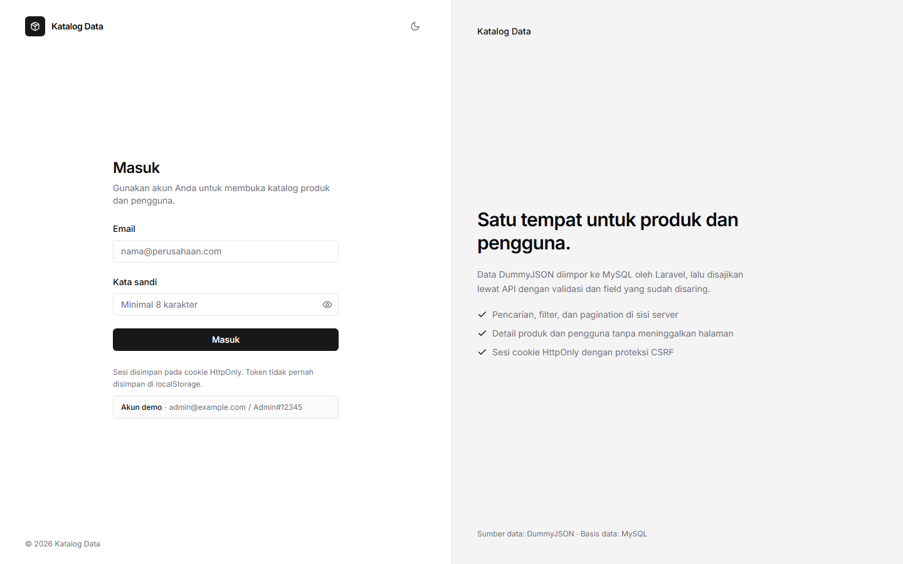
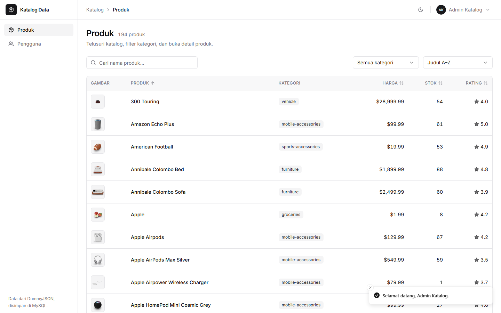
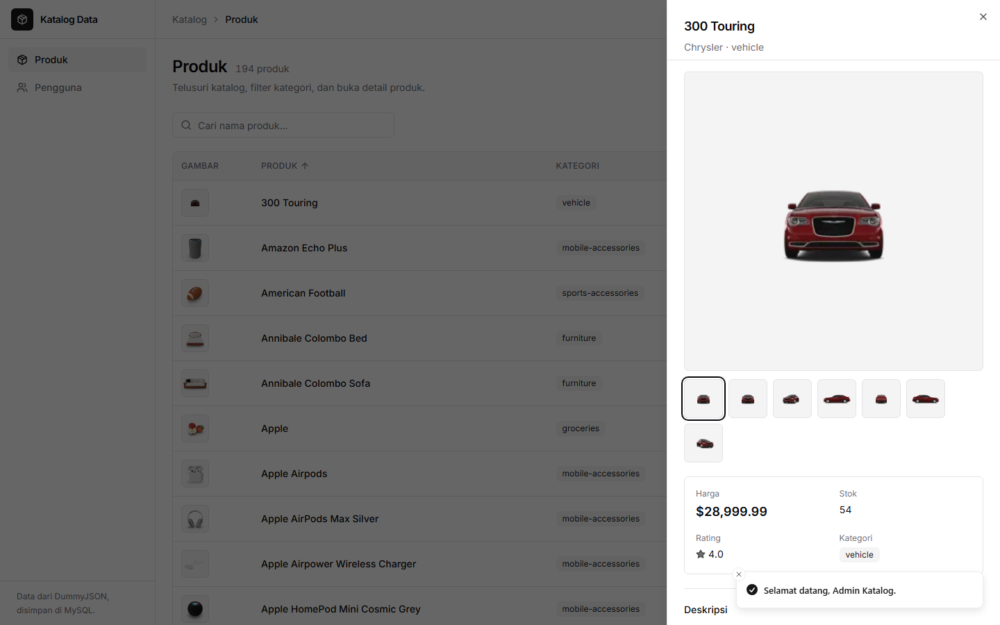
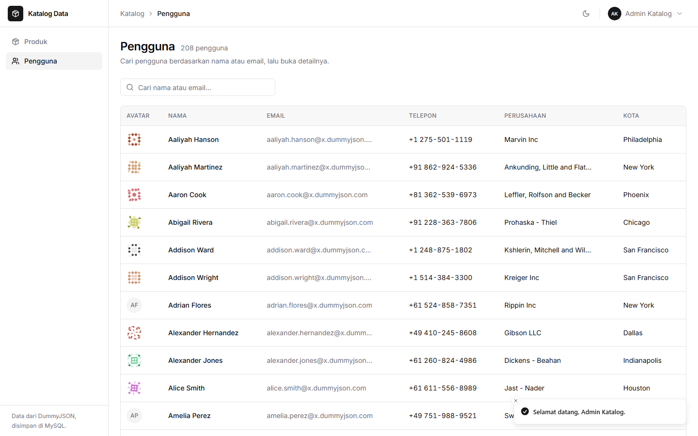
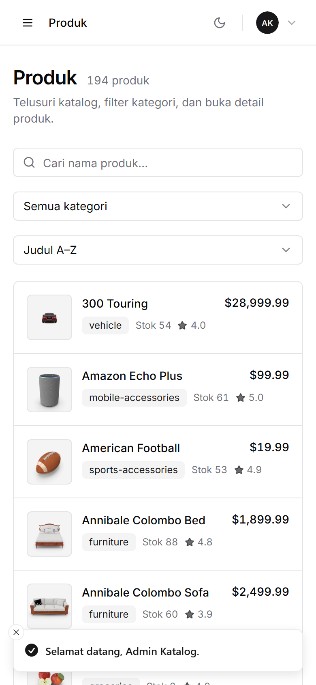

# Katalog Data

Aplikasi full-stack untuk login lalu menjelajahi **produk** dan **pengguna** dari DummyJSON. Data diimpor lebih dulu ke MySQL oleh Laravel, lalu disajikan lewat REST API sendiri; browser tidak pernah memanggil DummyJSON secara langsung.

- Frontend: React 18, TypeScript strict, Vite, Tailwind CSS, shadcn/ui
- Backend: Laravel 11, Sanctum SPA cookie auth, MySQL/MariaDB, Pest
- Akun demo: `admin@example.com` / `Admin#12345`

## Tampilan

| Login | Produk |
| --- | --- |
|  |  |

| Detail produk (Sheet) | Pengguna |
| --- | --- |
|  |  |

Tampilan mobile (tabel berubah menjadi daftar kartu):



## Fitur

- Login, logout, dan pemulihan sesi melalui cookie HttpOnly; seluruh halaman selain `/login` dilindungi.
- Pencarian produk (debounce 300 ms), filter kategori, sorting judul/harga/rating/stok/kategori, dan pagination server-side 10/20/50.
- Detail produk dalam Sheet: galeri gambar, harga, stok, rating, kategori, brand, dan deskripsi.
- Pencarian pengguna berdasarkan nama/email, pagination server-side, dan detail pengguna dalam Sheet.
- State URL dapat dibagikan dan tahan refresh: `?q=&category=&sort=&order=&page=&per_page=`.
- State loading, error, empty, 401, 403, 404, 422, 429, dan data tidak valid ditangani secara eksplisit.
- Dark mode yang mengikuti preferensi sistem dan dapat diubah manual; tema diingat di `localStorage`.
- Layout responsif: sidebar menjadi Sheet, tabel menjadi kartu di bawah 640 px, navigasi keyboard dan skip-link tersedia.

## Stack dan alasan pemilihan

| Bagian | Pilihan | Alasan |
| --- | --- | --- |
| Frontend | React 18 + TypeScript strict + Vite | Sesuai kebutuhan tes; build cepat dan tipe ketat menangkap error lebih awal. |
| Styling | Tailwind CSS 3 + shadcn/ui (Radix) | Token desain konsisten, aksesibel, dan mudah disesuaikan tanpa design system berat. |
| Ikon | lucide-react | Satu gaya ikon, ringan, dan tidak memakai emoji sebagai ikon. |
| Data fetching | TanStack Query v5 + Axios | Cache, deduplikasi, retry, state loading/error, dan `keepPreviousData` saat pagination. |
| Form | React Hook Form + Zod | Validasi client yang terketik dan terhubung ke pesan error per field. |
| Routing | React Router v6 | Protected route, redirect state, dan deep-link query string. |
| Tabel | TanStack Table | Headless: satu definisi kolom dipakai untuk tabel desktop dan kartu mobile. |
| Notifikasi | Sonner | Toast ringan untuk login/logout dan aksi berhasil. |
| Utilitas UI | `class-variance-authority`, `clsx`, `tailwind-merge` | Varian komponen shadcn dan penggabungan class yang aman. |
| Font | `@fontsource-variable/inter` | Inter variable font disajikan lokal, tanpa request ke Google Fonts. |
| Test frontend | Vitest, Testing Library, MSW | Test cepat di jsdom; MSW menguji alur HTTP nyata tanpa server. |
| Lint/format | Oxlint, ESLint, Prettier | Oxlint sebagai lint cepat, ESLint untuk aturan React/TypeScript, Prettier untuk format konsisten. |
| Backend | Laravel 11 + Sanctum | Autentikasi SPA berbasis cookie/CSRF tanpa token di browser, validasi dan resource bawaan. |
| Database | MySQL 8 / MariaDB 10.4+ | Relasional, cocok untuk pagination dan filter; kolasi `utf8mb4_unicode_ci` kompatibel dengan keduanya. |
| Test backend | Pest | Sintaks ringkas di atas PHPUnit, terintegrasi dengan Laravel. |

## Prasyarat

- PHP **8.2+** (diuji pada 8.2.12) dengan ekstensi `pdo_mysql`, `mbstring`, `openssl`, `json`, `ctype`, `fileinfo`.
- Composer 2.
- Node.js **>= 22.12** (dibutuhkan Vitest 5; Vite 8 mendukung 20.19+, tetapi tool test memilih 22.12+).
- MySQL 8 atau MariaDB 10.4+.
- npm 10+.

## Menjalankan aplikasi

### 1. Siapkan backend

```bash
cd backend
cp .env.example .env          # Windows PowerShell: Copy-Item .env.example .env
composer install
php artisan key:generate
```

Sesuaikan kredensial database di `backend/.env`:

```dotenv
DB_CONNECTION=mysql
DB_HOST=127.0.0.1
DB_PORT=3306
DB_DATABASE=coding_test_fe_v1
DB_USERNAME=root
DB_PASSWORD=
DB_COLLATION=utf8mb4_unicode_ci
```

Buat database (contoh):

```sql
CREATE DATABASE coding_test_fe_v1
  CHARACTER SET utf8mb4
  COLLATE utf8mb4_unicode_ci;
```

Jalankan migrasi dan seeder:

```bash
php artisan migrate --seed
```

Seeder mengisi 194 produk, 208 pengguna DummyJSON, dan akun admin. Data katalog dibaca dari snapshot JSON yang dibundel di `backend/database/seeders/data/`, jadi seeding tetap berjalan tanpa internet.

Opsional, ambil data terbaru langsung dari DummyJSON (butuh internet):

```bash
php artisan dummyjson:import --fresh
```

Perintah ini idempoten (upsert berdasarkan `external_id`), membuang field sensitif DummyJSON, dan dapat dijadwalkan ulang tanpa membuat data ganda. Jalankan `php artisan dummyjson:import` tanpa `--fresh` untuk memperbarui data yang ada.

### 2. Jalankan backend

```bash
php artisan serve
```

API berjalan di `http://127.0.0.1:8000`. Cek cepat:

```bash
curl -H "Accept: application/json" http://127.0.0.1:8000/api/v1/products
# 401 JSON karena endpoint dilindungi, bukan redirect HTML
```

### 3. Siapkan dan jalankan frontend

```bash
cd frontend
npm ci
npm run dev
```

Buka **http://localhost:5173**. Vite mem-proxy `/api` dan `/sanctum` ke `http://127.0.0.1:8000`, sehingga browser melihat satu origin dan cookie sesi/CSRF tetap bekerja tanpa konfigurasi CORS tambahan.

Jika port atau domain diubah, sesuaikan juga `SANCTUM_STATEFUL_DOMAINS`, `CORS_ALLOWED_ORIGINS`, dan `FRONTEND_URL` di `backend/.env`.

### 4. Build produksi frontend

```bash
cd frontend
npm run build
```

Hasil ada di `frontend/dist`. Sajikan melalui reverse proxy yang juga meneruskan `/api` dan `/sanctum` ke Laravel, atau sesuaikan origin CORS. Proxy Vite hanya untuk pengembangan.

## Akun demo

| Field | Nilai |
| --- | --- |
| Email | `admin@example.com` |
| Password | `Admin#12345` |
| Role | `admin` |

Akun dibuat oleh `AdminUserSeeder` dari variabel `ADMIN_NAME`, `ADMIN_EMAIL`, dan `ADMIN_PASSWORD` di `.env`. Ganti nilai tersebut sebelum production, lalu jalankan ulang:

```bash
php artisan db:seed --class=AdminUserSeeder
```

Password disimpan sebagai hash bcrypt (cost 12 pada konfigurasi default). Akun ini hanya untuk demo/test.

## Arsitektur

```text
Browser (React SPA)
   │  cookie HttpOnly + XSRF-TOKEN
   ▼
Vite dev proxy / reverse proxy
   │  /api/v1/*, /sanctum/*
   ▼
Laravel 11 API
   │  Form Request → Controller → Query/Mapper → API Resource
   ▼
MySQL / MariaDB  ◀── php artisan dummyjson:import
                     (atau snapshot JSON saat seed)
```

### Backend

```text
backend/
├─ app/
│  ├─ Console/Commands/ImportDummyJson.php
│  ├─ Http/
│  │  ├─ Controllers/Api/{AuthController,ProductController,UserController}.php
│  │  ├─ Middleware/SecurityHeaders.php
│  │  ├─ Requests/{LoginRequest,ProductIndexRequest,UserIndexRequest}.php
│  │  └─ Resources/{AuthUserResource,ProductResource,UserResource}.php
│  ├─ Models/{User,Product,AppUser}.php
│  ├─ Providers/AppServiceProvider.php      # rate limiter login/API
│  └─ Services/{DummyJsonClient,DummyJsonMapper,ProductQuery,UserQuery}.php
├─ database/
│  ├─ migrations/
│  ├─ seeders/                              # admin, snapshot produk/pengguna
│  └─ seeders/data/{products,users}.json    # snapshot offline
├─ routes/{api.php,web.php}
└─ tests/{Feature,Unit}/
```

- `users` khusus autentikasi; data pengguna DummyJSON disimpan terpisah di `app_users` agar identitas login tidak tercampur dengan data tampilan.
- `ProductQuery` dan `UserQuery` memusatkan filter, whitelist sorting, dan pagination. Sorting tidak pernah memakai nama kolom mentah dari input.
- `DummyJsonMapper` hanya membaca field yang diizinkan. Password, SSN, data bank/kartu, crypto, dan EIN tidak pernah masuk database atau respons API.
- `ProductResource`/`UserResource` adalah batas output: field baru di database tidak otomatis bocor ke klien.

### Frontend

```text
frontend/src/
├─ app/                 # router, providers, theme, query client, error boundary
├─ components/
│  ├─ ui/               # primitif shadcn/Radix
│  ├─ layout/           # sidebar, topbar, brand, menu akun
│  └─ shared/           # DataTable, PaginationBar, EmptyState, ErrorState, SearchInput
├─ features/
│  ├─ auth/             # api, schema, hooks, AuthProvider, LoginForm
│  ├─ products/         # api, types, mappers, params, hooks, tabel, filter, sheet
│  └─ users/            # struktur yang sama
├─ lib/                 # axios/CSRF, error parser, formatter, query params, navigation
├─ pages/               # Login, Products, Users, 403, 404
└─ test/                # setup Vitest + Testing Library
```

Pemisahan penting:

- Komponen dan halaman tidak memanggil Axios langsung. Semua akses data ada di `api.ts`/`hooks.ts`.
- Data mentah dari server dinormalisasi dan divalidasi Zod di `mappers.ts` (pure function). Item invalid dibuang, nilai opsional diberi fallback, dan kegagalan dicatat ke console hanya di mode development.
- URL adalah sumber kebenaran filter. `params.ts` mem-parsing query string, memvalidasi nilai, dan membangun URL berikutnya; filter yang tidak valid kembali ke default.
- `DataTable` generik menangani sorting, keyboard row activation, skeleton, error, empty state, serta render kartu mobile dari definisi kolom yang sama.

### Keputusan teknis

- **DummyJSON diimpor ke MySQL** agar frontend hanya berinteraksi dengan API sendiri, memenuhi syarat keamanan/validasi, dan tidak bergantung pada API pihak ketiga saat runtime.
- **Snapshot dibundel** agar demo dapat dijalankan offline dan hasil test/demo deterministik; `dummyjson:import` tetap tersedia untuk data terbaru.
- **USD** dipakai konsisten untuk harga karena DummyJSON menyajikan harga dalam USD. Tidak ada konversi kurs yang menyesatkan.
- **Pagination server-side** menjaga payload dan waktu render tetap wajar untuk 194 produk/208 pengguna.
- **`keepPreviousData`** membuat perpindahan halaman/filter tidak mengosongkan tabel; opacity dan `aria-busy` menandai refresh.
- **SQLite in-memory** dipakai hanya untuk test backend agar cepat dan tidak membutuhkan database eksternal. Aplikasi berjalan dengan MySQL/MariaDB.
- **Sanctum stateful** dipilih karena tidak menyimpan token di `localStorage`; cookie HttpOnly + CSRF lebih aman untuk SPA pada origin yang sama.

## Kontrak API

Base URL: `/api/v1`. Semua endpoint kecuali login membutuhkan sesi Sanctum.

| Method | Endpoint | Keterangan |
| --- | --- | --- |
| GET | `/sanctum/csrf-cookie` | Inisialisasi cookie sesi + XSRF (di luar `/api/v1`). |
| POST | `/auth/login` | Body `email`, `password`; throttle 5/menit. |
| POST | `/auth/logout` | Menghapus sesi server. |
| GET | `/auth/me` | Profil pengguna yang sedang login. |
| GET | `/products` | `q`, `category`, `sort`, `order`, `page`, `per_page`. |
| GET | `/products/{id}` | Detail produk untuk Sheet. |
| GET | `/products/categories` | Daftar kategori unik. |
| GET | `/users` | `q`, `page`, `per_page`. |
| GET | `/users/{id}` | Detail pengguna untuk Sheet. |

Nilai yang diizinkan:

- `sort`: `title`, `price`, `rating`, `stock`, `category`
- `order`: `asc`, `desc`
- `per_page`: `10`, `20`, `50`
- `q` dan `category`: maksimal 100 karakter

Respons list:

```json
{
  "data": [{ "id": 1, "title": "Essence Mascara Lash Princess", "price": 9.99 }],
  "meta": { "current_page": 1, "per_page": 20, "total": 194, "last_page": 10 }
}
```

Respons validasi:

```json
{
  "message": "Data tidak valid.",
  "errors": { "per_page": ["Jumlah per halaman harus 10, 20, atau 50."] }
}
```

## Keamanan

| Kontrol | Implementasi |
| --- | --- |
| Sesi | Sanctum SPA cookie; `HttpOnly`, `SameSite=Lax`, `Secure` saat HTTPS; tidak ada token di `localStorage`. |
| CSRF | Cookie XSRF diambil sebelum login; Axios mengirim header; 419 ditangani dengan satu kali refresh cookie lalu retry. |
| Password | Hash bcrypt cost 12; pesan login selalu generik; dummy hash menjaga waktu respons saat email tidak terdaftar. |
| Session lifecycle | Session ID diregenerasi saat login; logout menghapus sesi dan meregenerasi token CSRF. |
| Rate limit | Login 5/menit per email+IP, API 60/menit per pengguna/IP; 429 + `Retry-After`; UI menampilkan hitung mundur. |
| Validasi | Form Request untuk semua input, whitelist field, batas panjang, tipe, enum sort/order/per_page. |
| Query | Eloquent/query builder dengan binding; sorting hanya dari `ProductQuery::SORTS`, bukan input bebas. |
| Output | API Resource menyaring field; import DummyJSON membuang password, SSN, bank, kartu, crypto, EIN. |
| XSS | React meng-escape teks; tidak ada `dangerouslySetInnerHTML`; deskripsi DummyJSON di-`strip_tags` saat import. |
| Header | `X-Content-Type-Options`, `X-Frame-Options: DENY`, `Referrer-Policy`, `Permissions-Policy`, CSP untuk API, HSTS saat HTTPS. |
| CORS | Hanya origin frontend dari `CORS_ALLOWED_ORIGINS`, `supports_credentials=true`, tanpa wildcard. |
| Redirect | `safeRedirectTarget` menolak target non-lokal, protocol-relative (`//`), dan halaman login agar tidak terjadi open redirect. |
| 401 | Interceptor Axios memancarkan event global, membersihkan cache sesi, dan mengarahkan ke `/login` dengan pesan sesi berakhir. |
| Log | `storage/logs/security.log`: login sukses/gagal, throttle, 401, 403, logout. Password/token tidak dicatat. |
| Konfigurasi | Secret hanya di `.env`; `.env.example` disediakan tanpa kredensial asli. |

### Checklist production

1. Set `APP_ENV=production`, `APP_DEBUG=false`, `APP_URL=https://...`, dan HTTPS di reverse proxy.
2. Set `SESSION_SECURE_COOKIE=true`, `SESSION_DOMAIN`, `SANCTUM_STATEFUL_DOMAINS`, dan `CORS_ALLOWED_ORIGINS` sesuai domain final.
3. Ganti `ADMIN_EMAIL`/`ADMIN_PASSWORD`, lalu seed ulang akun admin.
4. Jalankan `php artisan config:cache`, `route:cache`, dan `view:cache`; arahkan document root ke `backend/public`.
5. Sajikan `frontend/dist` melalui reverse proxy dan teruskan `/api` serta `/sanctum` ke Laravel.
6. Pantau `security.log`, pasang rotasi log, dan batasi akses ke file `.env`.
7. Upgrade dependensi sebelum production (lihat bagian audit di bawah).

## Penanganan state

| State | Perilaku |
| --- | --- |
| Loading | Skeleton menyerupai tabel/kartu; bukan spinner layar penuh. |
| Refreshing | Data lama dipertahankan, opacity diturunkan, `aria-busy` aktif. |
| Error jaringan/server | `ErrorState` dengan tombol "Coba lagi" (refetch); detail teknis tidak ditampilkan. |
| Empty | `EmptyState` dengan konteks filter dan aksi "Reset filter". |
| 401 | Sesi dibersihkan dan pengguna diarahkan ke login. |
| 403/404 | Halaman khusus atau empty state yang jelas. |
| 422 | Pesan per field di bawah input; fokus dipindahkan ke field pertama yang salah. |
| 429 | Pesan throttle, tombol submit dinonaktifkan, hitung mundur dari `Retry-After`. |
| Data invalid | Zod `safeParse`; item dibuang atau fallback; gambar non-HTTP/broken menjadi placeholder. |

## Pengujian

Backend (SQLite in-memory, 20 test / 106 assertion):

```bash
cd backend
php artisan test
./vendor/bin/pint --test
```

Yang dicakup: login sukses/gagal, throttle, logout stateful, endpoint terproteksi, validasi query, pencarian/filter/sort/pagination, kategori, detail 404, field sensitif tidak bocor, impor idempoten, sanitasi data, dan kegagalan DummyJSON.

Frontend (28 test):

```bash
cd frontend
npm test
npm run lint
npm run format:check
npm run build
```

Yang dicakup: mapper produk/pengguna (valid, invalid, fallback, meta), `EmptyState`/`ErrorState`, validasi `LoginForm`, error 422 per field, throttle 429, login sukses + redirect, dan hook produk dengan MSW (query string, mapping, error).

Verifikasi UI lokal juga dilakukan dengan Chrome headless: login → pencarian produk dan sinkronisasi URL → buka/tutup Sheet → halaman pengguna dan pencarian → dark mode → logout → redirect rute terlindungi.

## Audit dependensi

Perintah audit tetap dijalankan, tetapi ada temuan yang memerlukan upgrade mayor di luar versi yang diminta brief:

```text
composer audit  → 5 advisory pada laravel/framework 11.57.0
npm audit       → 7 advisory: 4 high (runtime), 3 moderate (rantai build Tailwind/PostCSS)
```

- **Laravel 11**: beberapa advisory hanya diperbaiki di Laravel 12.60+/12.68+, sedangkan brief meminta Laravel 11. Mitigasi yang sudah diterapkan: tidak memakai TokenGuard/bearer token, tidak memakai temporary signed URL, `APP_DEBUG=false` di production, tidak merender HTML dari input pengguna, dan validasi email di server. Ini tidak menghapus risiko framework; upgrade ke Laravel 12 LTS direkomendasikan sebelum production.
- **React Router 6**: advisory open redirect/XSS pada `@remix-run/router`; perbaikannya memerlukan React Router 7. Aplikasi sudah memakai `safeRedirectTarget` dan tidak menerima URL eksternal, tetapi upgrade tetap disarankan.
- **Zod 3**: advisory memory exhaustion pada validasi koleksi berukuran ekstrem; perbaikan memerlukan Zod 4. Payload API dibatasi pagination 50 item dan query string divalidasi, sehingga paparan dikurangi.
- **Tailwind 3/PostCSS**: advisory moderate pada rantai build (bukan runtime browser); perbaikan memerlukan Tailwind 4.

Kesimpulan: aplikasi ini berstatus demo/test dan belum disarankan untuk production sampai dependensi di-upgrade. Detail advisory dapat dilihat dengan `composer audit` dan `npm audit`.

## Lisensi

Kode dibuat untuk keperluan coding test. Data produk dan pengguna berasal dari [DummyJSON](https://dummyjson.com).
